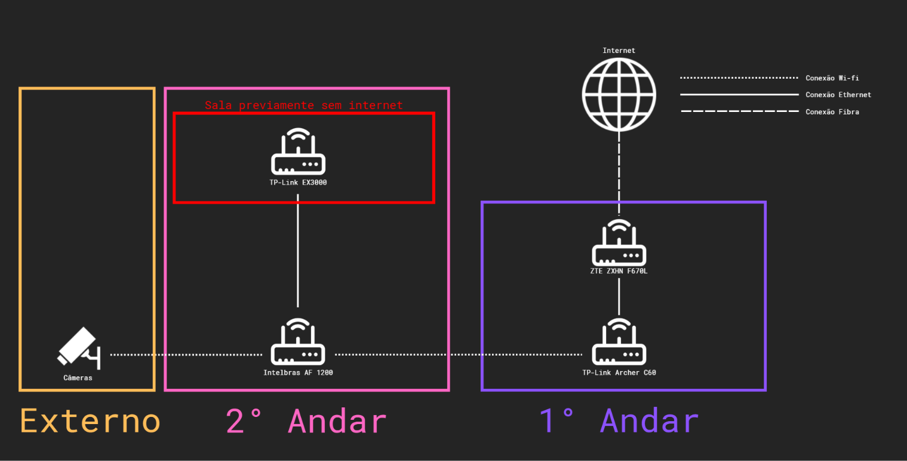
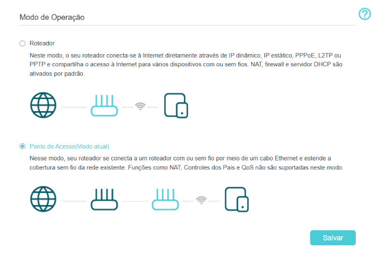
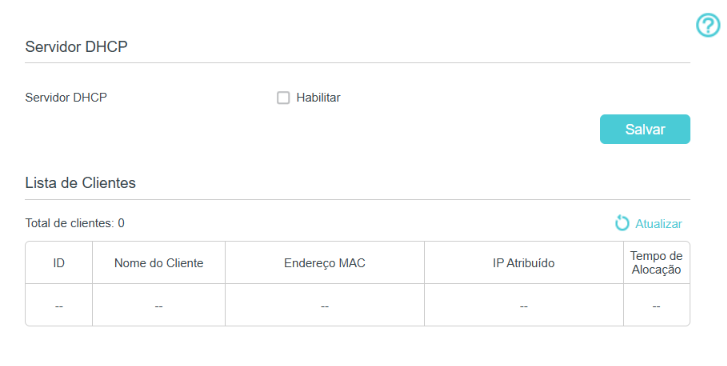

# Diagnóstico e expansão de infraestrutura de rede


## Sobre o projeto

Este repositório documenta uma atividade prática de infraestrutura de redes realizada em um ambiente com equipamentos e dispositivos previamente instalados.

O trabalho consistiu na integração de um ponto de acesso TP-Link EX3000 à infraestrutura existente, com o objetivo de disponibilizar conectividade em uma sala que anteriormente não possuía acesso à internet.

Durante a atividade, foram analisadas as conexões entre os equipamentos, realizada a configuração do novo ponto de acesso e executados testes de conectividade para verificar a comunicação com a rede existente.

O processo também envolveu a necessidade de manter os dispositivos que já utilizavam a infraestrutura em funcionamento durante a implementação.

## Objetivos

- Analisar a topologia de uma rede existente.
- Integrar um novo equipamento à infraestrutura.
- Disponibilizar conectividade em uma área sem acesso à internet.
- Verificar a comunicação entre os dispositivos.
- Documentar as configurações, os testes realizados e os resultados observados.

## Topologia da rede

A infraestrutura utilizada na atividade era composta por equipamentos de rede distribuídos entre diferentes áreas do ambiente.

A conexão principal parte do equipamento ZTE ZXHN F670L, passa pelo roteador TP-Link Archer C60 e chega ao Intelbras AF 1200, que disponibiliza conectividade para a área onde estão instaladas as câmeras.

A partir do Intelbras AF 1200, foi integrado um TP-Link EX3000 por meio de uma conexão Ethernet, utilizando o modo Access Point para disponibilizar uma rede Wi-Fi adicional.

### Diagrama da infraestrutura



### Equipamentos envolvidos

| Equipamento | Função na infraestrutura |
|---|---|
| ZTE ZXHN F670L | Equipamento principal de acesso à rede |
| TP-Link Archer C60 | Roteador da rede local |
| Intelbras AF 1200 | Equipamento responsável pela conectividade da área das câmeras |
| TP-Link EX3000 | Ponto de acesso adicional |
| Câmeras | Dispositivos conectados à infraestrutura existente |
| Notebook  | Dispositivo utilizado para configuração e testes |

O diagrama representa as conexões físicas e sem fio identificadas durante a atividade. Os detalhes de configuração e funcionamento lógico da rede são abordados nas próximas seções.

## Implementação

A implementação consistiu na integração de um TP-Link EX3000 à infraestrutura existente, com o objetivo de disponibilizar conectividade Wi-Fi em uma sala que anteriormente não possuía acesso à rede.

### Configuração do Access Point

O TP-Link EX3000 foi configurado em modo **Access Point (AP)**, permitindo que o equipamento disponibilizasse conectividade sem fio utilizando a infraestrutura de rede existente.

O servidor DHCP do EX3000 foi desativado, mantendo a distribuição de endereços IP sob responsabilidade do servidor DHCP já presente na rede.

O equipamento também recebeu um endereço IP estático dentro da sub-rede local, fora do intervalo destinado à distribuição dinâmica de endereços DHCP. Essa configuração facilita a identificação do equipamento e mantém seu endereço de administração previsível, permitindo acessar o painel de gerenciamento sem precisar descobrir seu IP a cada alteração de concessão DHCP.

#### Evidências da configuração

**Modo de operação:**



**Servidor DHCP:**



**Configuração LAN:**


## Testes e validação

Após a configuração do ponto de acesso, foram realizados testes para verificar a conectividade do notebook com a rede local e com a internet.

### Obtenção de endereço IP

Foi utilizado o comando `ipconfig` para verificar os parâmetros de rede recebidos pelo notebook.

O dispositivo recebeu o endereço IPv4 `192.168.0.124`, pertencente à sub-rede local, com o gateway padrão `192.168.0.1`.

Esse resultado confirmou a obtenção de uma configuração IPv4 válida por meio do DHCP da rede.

### Conectividade com o gateway

Foi utilizado o comando `ping 192.168.0.1` para verificar a comunicação entre o notebook e o gateway da rede.

O teste apresentou respostas aos quatro pacotes enviados, sem perda de pacotes.

### Conectividade externa

Para verificar a comunicação com um endereço IP externo, foi executado:

```cmd
ping 8.8.8.8
```

O destino respondeu aos quatro pacotes enviados, demonstrando conectividade IP com um endereço externo.

### Resolução de nomes DNS

Foi utilizado o comando `nslookup google.com` para verificar a resolução de nomes de domínio.

A consulta retornou endereços IPv4 e IPv6 associados ao domínio, confirmando o funcionamento da resolução DNS.

### Acesso administrativo

Também foi confirmado o acesso ao painel administrativo do TP-Link EX3000 após a implementação, permitindo verificar que o equipamento permanecia acessível para gerenciamento.

### Resultado dos testes

Os testes realizados demonstraram que o notebook conseguiu obter uma configuração IPv4 válida, comunicar-se com o gateway, alcançar um endereço externo e resolver nomes de domínio.

Com isso, foi confirmada a conectividade entre o ponto de acesso integrado, a rede local e a internet.

### Conexão física

A integração foi realizada por meio de um cabo Ethernet entre a porta LAN 1 do Intelbras AF 1200 e a porta WAN do TP-Link EX3000.

Essa conexão permitiu que o EX3000 operasse como ponto de acesso, disponibilizando conectividade Wi-Fi para os dispositivos na área atendida.

## Problemas encontrados e resolução

Durante a implementação e os testes, foram observadas duas situações que exigiram investigação.

### Endereço IP pertencente a outra sub-rede

Em uma das primeiras verificações, após conectar o notebook à rede Wi-Fi do TP-Link EX3000, foi recebido o endereço IPv4 `192.168.1.32`, com máscara `255.255.255.0` e gateway `192.168.1.1`.

Essa configuração pertencia a uma sub-rede diferente da esperada (`192.168.0.0/24`) e foi associada à rede do equipamento ZTE.

A origem exata dessa atribuição não foi identificada durante a atividade. Portanto, não foi possível determinar por que o notebook recebeu um endereço dessa sub-rede naquele momento.

### Alteração na conexão física

Durante a atividade, outra pessoa alterou a conexão Ethernet entre o Intelbras AF 1200 e o TP-Link EX3000, retirando o cabo da porta LAN 1 e conectando-o à porta Internet (WAN) do AF 1200.

Após essa alteração, o notebook ainda conseguia se conectar à rede Wi-Fi do EX3000, mas não recebia uma configuração IPv4 válida. Foi observado um endereço APIPA (`169.254.x.x`), sem gateway IPv4, e o painel administrativo do EX3000 ficou inacessível.

Ao retornar o cabo à porta LAN 1 do AF 1200, a comunicação com a rede foi restabelecida. O notebook voltou a receber um endereço IPv4 válido (`192.168.0.124`), o gateway `192.168.0.1` tornou-se acessível e o painel administrativo do EX3000 pôde ser acessado novamente.

A ocorrência evidenciou a importância de verificar as conexões físicas e as portas utilizadas durante a integração dos equipamentos.

## Conclusão

A atividade resultou na integração do TP-Link EX3000 à infraestrutura de rede existente, disponibilizando conectividade Wi-Fi em uma sala que anteriormente não possuía acesso à internet.

O equipamento foi configurado em modo Access Point, com o servidor DHCP desativado e um endereço IP estático para gerenciamento. A conexão com o Intelbras AF 1200 foi estabelecida pela porta LAN 1, mantendo a comunicação com a rede existente.

Os testes realizados confirmaram que o notebook conseguiu obter um endereço IPv4 válido, comunicar-se com o gateway, alcançar um endereço IP externo, resolver nomes de domínio e acessar o painel administrativo do ponto de acesso.

Durante o processo, também foram identificadas situações que exigiram investigação, incluindo uma atribuição inicial de endereço IP pertencente a outra sub-rede e uma alteração indevida na conexão física entre os equipamentos. Embora nem todas as ocorrências tenham tido sua origem determinada, os testes permitiram identificar e corrigir o problema relacionado à conexão física.

A atividade proporcionou experiência prática com análise de topologia, configuração de Access Point, endereçamento IPv4, DHCP, DNS e diagnóstico de conectividade em uma infraestrutura já existente.
